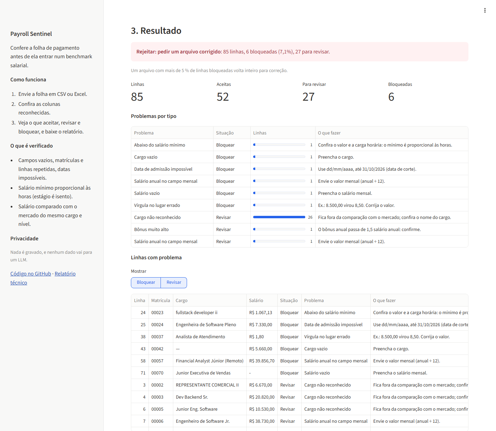
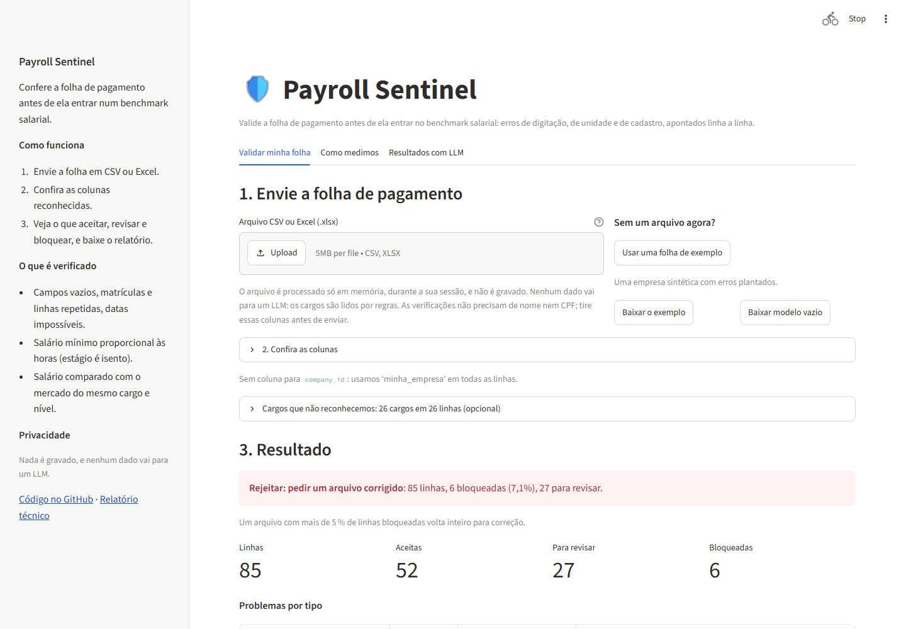
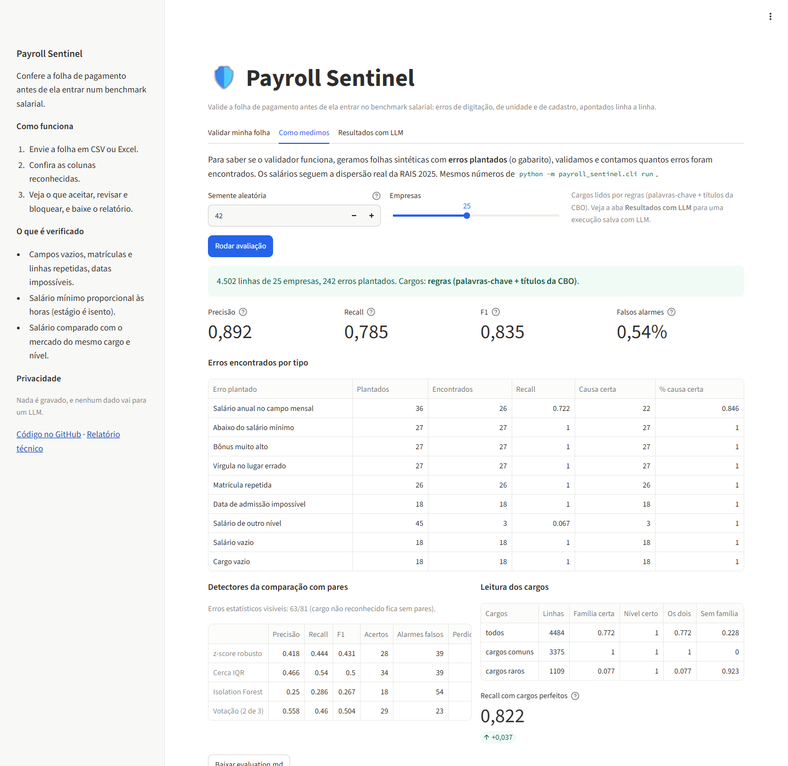
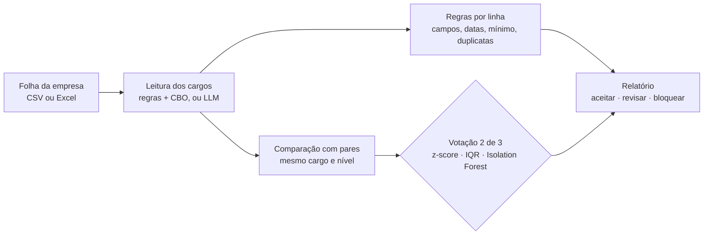

# Payroll Sentinel

[](https://github.com/DanielznRtm/payroll-sentinel/actions/workflows/tests.yml)

[](LICENSE)
[](https://payroll-sentinel.streamlit.app)
[](https://huggingface.co/spaces/Danielrtm1/payroll-sentinel)

**Confere folhas de pagamento antes de elas entrarem num benchmark salarial: aponta,
linha a linha, o que aceitar, revisar e bloquear, com o motivo e o que fazer.**

**▶ [Ver o resultado de uma folha de exemplo](https://payroll-sentinel.streamlit.app/?exemplo)**
(um clique, sem instalar nada) · [Rodar inteiro no navegador](https://huggingface.co/spaces/Danielrtm1/payroll-sentinel)
· English: [technical report](docs/technical-report.md)



Benchmarks salariais são montados com folhas que dezenas de empresas enviam. Um
salário anual digitado no campo mensal, um `8.500,00` lido como `8,5` ou um sênior
pago como estagiário já distorcem a mediana do mercado para todos. Alguns erros
aparecem numa linha só; outros, só comparando o salário com o de todos os pares.
Cada número deste projeto foi **medido**: em dados sintéticos com erros plantados e
rotulados, em cargos e perguntas reais escritos à mão e em bases públicas e oficiais.

## O que este projeto demonstra

* **LLM com guarda-corpos.** Um LLM (Gemini, plano gratuito, por uma API compatível
  com a da OpenAI) lê cargos escritos de qualquer jeito. Os títulos vão em lotes, com
  cache por modelo, respeito ao limite de requisições e validação de cada resposta. O
  LLM nunca produz um número mostrado ao usuário.
* **Avaliação antes de opinião.** Há um gabarito com erros plantados, 130 cargos
  reais rotulados à mão e separados do desenvolvimento, e uma comparação de três
  modelos em acurácia, latência e custo. Uma ablação com cargos perfeitos mostra onde
  está o limite.
* **Pergunta em linguagem natural, executada com segurança.** O LLM só preenche uma
  consulta JSON de formato fixo; o código confere cada campo numa lista permitida e
  calcula a resposta. Resultado: 27 de 30 perguntas certas e 5 de 5 fora do escopo
  recusadas.
* **Detecção de anomalias explicável.** Regras do direito trabalhista brasileiro mais
  três detectores que votam (z-score robusto, IQR e Isolation Forest), com a causa
  provável de cada alerta.
* **Dados reais.** O validador foi rodado em três bases públicas. O gerador sintético
  foi calibrado com 25,5 milhões de linhas da RAIS 2025, lidas em streaming de um
  `.7z`. Uma pesquisa salarial (State of Data) serve de checagem independente.
* **Produto de ponta a ponta.** São dois sites gratuitos: um no servidor e outro que
  roda Python no navegador (WebAssembly), em que a folha nunca sai do computador. Há
  privacidade desde o desenho (LGPD), 104 testes automatizados e CI no GitHub Actions.

**Stack:** Python · pandas · scikit-learn · Streamlit · stlite/Pyodide · Gemini e
Groq (API compatível com a da OpenAI) · pytest · GitHub Actions.

<details>
<summary>Mais telas</summary>





</details>

## Um exemplo

Uma empresa envia (números ilustrativos):

| Funcionário | Cargo | Salário mensal |
|---|---|---|
| Ana | Analista de Dados Pleno | R$ 7.200 |
| Bruno | Analista de Dados Pleno | R$ 86.400 |
| Carla | Operadora de Produção | R$ 1.200 |
| Diego | HRBP Sr | R$ 9.800 |

O Payroll Sentinel responde:

| Funcionário | Situação | Por quê |
|---|---|---|
| Ana | aceitar | Em linha com outros analistas de dados plenos |
| Bruno | bloquear | Cerca de 12× a mediana dos pares: salário anual no campo mensal (7.200 × 12) |
| Carla | bloquear | Abaixo do mínimo de 2026, R$ 1.621 para 44 h/semana |
| Diego | aceitar | O LLM lê `HRBP Sr` como *analista de RH, sênior* e o compara com os pares certos. As regras sozinhas não reconhecem o cargo; no site, a empresa escolhe a família |

Decisão: com mais de 5 % das linhas bloqueadas, a empresa recebe o arquivo de volta para corrigir.

## Resultados

| O quê | Resultado |
|---|---|
| Erros encontrados (recall), com cargos lidos por LLM | **82 %** (precisão 91 %) |
| O mesmo, com os salários pouco espalhados da v1.0 | 97 % |
| Cargos reais mapeados para a família certa | **97,4 %** com LLM, 63,2 % com regras |
| Folha de uma empresa sozinha, erros encontrados | **79 %** contra o mercado de referência, 70 % sem ele |
| Perguntas respondidas certo / fora do escopo recusadas | 27 de 30 / 5 de 5 |
| Base pública indiana: linhas que chegam à comparação | 99,2 % com LLM, 2,7 % com regras |
| Custo | R$ 0 (LLM em plano gratuito) |

Os salários sintéticos têm a dispersão real de 361.437 empregos da RAIS 2025, o
registro oficial do Ministério do Trabalho. Com essa dispersão, um salário de outro
nível (2,4 a 3,3 vezes fora) se esconde entre salários normais: só 4 de 45 são
achados. Esse é o limite atual, e nenhum detector de outliers resolve: seria
preciso a tabela salarial da própria empresa. Método, tabelas e limites de cada
número: [relatório técnico](docs/technical-report.md) (em inglês).

## Como funciona



* **Regras** pegam erros de uma linha só: campos vazios, matrículas e linhas
  repetidas, datas impossíveis, bônus exagerado e salário abaixo do mínimo. O
  mínimo (R$ 1.621 em 2026) é proporcional às horas, e estágio é isento: um
  simples `salário < 1621` acusaria meio período e estagiário legítimos.
* **Comparação com pares** compara cada salário com os do mesmo cargo e nível em
  todas as empresas. Três detectores votam, e a linha é marcada quando dois
  concordam: a votação mantém o recall e corta os falsos alarmes.
* **Causa provável**: cerca de 12× a mediana é salário anual no campo mensal; cerca
  de 1/12 é mensal dividido por 12; entre 6× e 9× pode ser um salário alto de
  verdade, então vai para revisão; acima de 30× não é salário.
* **Leitura dos cargos** transforma `Dev Backend Sr.` ou `ANALISTA DE BI II` numa
  família e num nível. Sem isso a linha não tem pares. O LLM só lê texto; todo
  número mostrado vem de código Python determinístico, com testes.

## Versões

| Versão | O que mudou |
|---|---|
| **v1.0** | Módulo A completo: validador, cargos por LLM, 130 cargos reais escritos à mão, comparação de modelos, perguntas em linguagem natural, demo público e estudo em bases públicas. F1 0,92 com regras e 0,963 com LLM, num mundo de salários pouco espalhados. |
| **v1.1** | Títulos oficiais da CBO nas regras; gerador calibrado com a RAIS (dispersão por família, índice de cidade para escritório e fábrica, vendas B2B). O validador é o mesmo, mas os dados ficaram realistas: F1 0,835 com regras e 0,865 com LLM. Os números da v1.1 são os que valem. |
| **próxima** | Site em português para a empresa enviar a folha (CSV ou Excel), com comparação contra um mercado de referência, em dois sites gratuitos: no servidor e no navegador. |

Detalhes em [CHANGELOG.md](CHANGELOG.md).

## Formato da folha

Uma linha por pessoa. O site reconhece os nomes comuns e deixa trocar a coluna à mão.

| Campo | Nomes reconhecidos (exemplos) | Obrigatório |
|---|---|---|
| Matrícula | Matrícula, ID do funcionário | sim |
| Cargo | Cargo, Função | sim |
| Tipo de contrato | Tipo de contrato, Vínculo (CLT, Estágio...) | sim |
| Horas por semana | Carga horária, Jornada (`44`, `44h`) | sim |
| Salário mensal | Salário, Salário base (`R$ 8.500,00`) | sim |
| Data de admissão | Admissão, Data de admissão (`25/03/2020`) | sim |
| Bônus anual | Bônus, PLR | não (0) |
| Empresa | Empresa, CNPJ | não (uma empresa por arquivo) |

Nome e CPF não são usados: tire essas colunas antes de enviar.

## Rode no seu computador

```bash
python -m venv .venv && source .venv/bin/activate     # Windows: .venv\Scripts\activate
pip install -e ".[dev,ui]"
streamlit run app.py --server.address localhost       # o site, em http://localhost:8501
python -m payroll_sentinel.cli run                     # avaliação completa em dados sintéticos
python -m payroll_sentinel.cli validate folha.csv      # pelo terminal, com as colunas de data/submissions.csv
pytest                                                 # 104 testes
```

No Windows, basta dar dois cliques em `run_ui.bat`. O LLM é opcional e gratuito
(Gemini, Groq ou Ollama local); a configuração está no
[relatório técnico](docs/technical-report.md#optional-llm-title-normalization-free-tiers).

## O que aprendi

1. **Primeiro os cargos, depois o limite de detecção.** Sem família, a linha não
   tem pares. As regras leem 100 % dos cargos comuns e só 7,7 % dos raros; o LLM
   leva o recall ao mesmo valor que teria com cargos perfeitos.
2. **Regras primeiro.** Sete dos nove tipos de erro chegam a 100 % de recall só
   com regras, de graça e com uma explicação que qualquer pessoa entende.
3. **Um benchmark sintético é tão honesto quanto o seu ruído.** A v1.0 media recall
   de 97 % com uma dispersão que eu escolhi. Calibrada com dados reais, a mesma
   medida caiu para 82 % sem mudar uma linha do validador.
4. **Dados reais acham os erros que você não plantou.** Bases públicas mostraram
   salário mensal no campo anual, salários altos legítimos e linhas copiadas com
   outra matrícula. Cada correção foi medida antes de entrar.

## Limitações

* Os dados são sintéticos. A RAIS não tem nível de senioridade, então quanto da
  dispersão real fica dentro de um grupo de pares é uma hipótese (a v1.1 coloca
  toda ela lá, o que é pessimista).
* O mercado de referência do site também é sintético: numa implantação real, seria
  o próprio benchmark validado.
* Os 130 cargos reais e as 30 perguntas foram escritos e rotulados por uma pessoa,
  e cada modelo rodou uma vez.

## Roteiro

| Módulo | O que faz | Situação |
|---|---|---|
| **A. Payroll Sentinel** | Confere folhas antes de entrarem num benchmark salarial | v1.1, este repositório |
| **B. Triagem de ações trabalhistas** | Lê a petição, extrai cada pedido com LLM e confere com a folha validada; impostos e verbas vêm de um motor de cálculo determinístico | Planejado |
| **C. Salário justo** | Diz se um salário é justo: percentil de mercado, líquido e CLT vs. PJ | Especificado |

A ordem é de propósito: os cálculos do B só valem se a folha estiver certa, e as
comparações do C só valem se os dados por trás estiverem limpos.

## Licença

[MIT](LICENSE)
